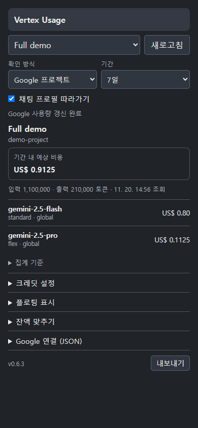
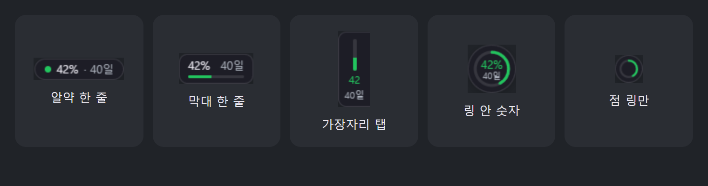

# Vertex Usage for SillyTavern

 

Vertex 연결 프로필을 선택해 대화 사용량·예상 비용과 크레딧 기간의 잔액 추정을 봅니다. 기본 모드는 기존 익스프레스 키로 대화하는 동안 토큰을 수집하므로 별도 JSON이 필요하지 않습니다. Google Monitoring 프로젝트 전체 조회는 선택 기능입니다. **서버 플러그인·BigQuery·별도 프록시 없이 브라우저가 Google에 직접 연결합니다.**

## 설치와 기본 사용: JSON 없이

1. 실리태번 **확장 → 확장 설치**에 `https://github.com/STLoft/Vertex-Usage`를 넣어 설치하고 브라우저를 새로고침합니다. 직접 설치할 때는 이 폴더를 `public/scripts/extensions/third-party/` 아래에 넣습니다. 서버 플러그인이나 서버 재시작은 필요 없습니다.
2. Vertex 연결 프로필을 선택하고 **확인 방식: 대화 기록**으로 대화하세요. 실리태번에 저장된 익스프레스/풀 모드 연결을 그대로 사용합니다. 키 문자열·모델명·단가를 다시 입력하지 않습니다.
3. **크레딧 설정**에 총액(기본 $300), 활성화/만료 날짜, 같은 크레딧을 쓰는 대상 프로필을 지정합니다. 날짜 하나만 입력하면 빈 날짜를 90일 기준으로 채우지만 둘 다 수정할 수 있습니다. 실제 기간은 각 사용자가 Google에 표시된 날짜로 설정하세요.
4. 이미 사용 중인 크레딧이면 **현재 Google 잔액**을 한 번 입력한 뒤 **저장**을 누르세요. 이전 사용분은 이 기준에 반영하고, 이후 수집된 대화 비용을 차감합니다. 저장한 금액과 기준 시각도 화면에 표시합니다. 빈칸으로 다시 저장하거나 날짜·대상 프로필을 수정해도 기존 기준이 해당 기간 안에 있고 잔액이 새 총액 이하이면 유지합니다. 새 크레딧 기간으로 바꾸면 현재 잔액을 다시 입력하세요.

## 플로팅 잔량 표시

크레딧 설정 후 작은 표시가 화면에 나타납니다. **플로팅 표시** 설정에서 켜기/끄기, 모양 **알약 한 줄 / 막대 한 줄 / 가장자리 탭 / 링 안 숫자 / 점 링만**, **남은 % / 사용한 %**를 선택할 수 있습니다. 퍼센트(정수)와 남은 일수를 보여 주며, 가장자리 탭은 화면 좌우 끝에 붙고, 점 링만은 숫자 없이 링만 보입니다. 30% 이하는 주황, 10% 이하는 빨강입니다. 정확한 퍼센트·금액은 마우스를 올리거나 눌러서 여는 상세에서 볼 수 있습니다. 끌어서 위치를 옮길 수 있고 실리태번 테마 색상을 따릅니다.

패널을 드래그해 이동하면 이 브라우저·실리태번 사용자에 위치를 기억합니다. **위치 초기화**로 되돌릴 수 있으며 화면이 작아져도 가장자리 안으로 배치합니다. 패널을 켜 두면 확장 설정이 닫혀 있어도 기존 5분 주기로 선택한 Google 프로젝트를 갱신합니다. 대화 사용량 모드만 사용하면 추가 Google 조회는 하지 않습니다.

현재 잔액 기준이 저장되어 있지만 Google 기록이나 단가가 부족하면 그 기준에서 **확인된 사용분만 차감한 잔액**을 `≈`와 **일부 사용분 미반영**으로 표시합니다. 미집계 비용 때문에 실제 잔액보다 높을 수 있으며, 잔액 재입력 대신 JSON 연결·권한·단가를 확인하세요. 기준을 아직 입력하지 않았고 과거 전체 기록도 없다면 퍼센트는 `—`로 표시합니다.

간편 모드는 설치·실행 후 이 브라우저를 통과한 `/api/backends/chat-completions/generate`의 Vertex 요청만 수집합니다. 브라우저를 닫았을 때나 다른 앱·기기에서 사용한 금액은 자동으로 알 수 없습니다. 따라서 과거 전체 사용량이나 Google 실제 잔액을 조회한 것으로 표시하지 않습니다.

스트리밍 응답에 `usageMetadata`가 있으면 입력·캐시·출력·사고 토큰을 사용합니다. 사고 토큰은 출력 요금에 한 번만 포함합니다. 실리태번 비스트리밍 응답에서 원본 토큰 정보가 빠지면 입력은 실리태번 토크나이저, 출력은 문자 수로 추정하고 로컬 추정으로 표시합니다. 중단된 요청도 일부만 관측됐다는 표시를 합니다. 원래 채팅 요청·응답은 변경하지 않습니다.

저장된 프로필의 키 ID와 인증 모드를 이용해 요청을 연결합니다. 같은 인증을 공유해 프로필을 구분할 수 없는 요청은 임의의 프로필에 넣지 않습니다. 키의 값은 읽거나 새로 저장하지 않습니다.

## 선택: Google 프로젝트 전체 조회

확인 방식을 **Google 프로젝트**로 바꾸면 Google Cloud Monitoring 통계를 사용합니다.

1. 서비스 계정 JSON을 한 번 등록하세요. 프로젝트 ID는 JSON과 저장된 프로필 설정에서 읽습니다. 기존에 브라우저에 등록한 JSON을 다시 선택할 수도 있습니다.
2. 조회할 프로젝트마다 그 JSON의 `client_email` 계정에 **모니터링 뷰어** (`roles/monitoring.viewer`)를 부여하고 Cloud Monitoring API를 켜세요. 자세한 방법은 아래 **Monitoring 권한 설정 자세히**에 있습니다.
3. JSON 계정에 여러 프로젝트의 조회 권한이 있으면 하나의 JSON을 재사용할 수 있습니다. 익스프레스 프로필의 프로젝트 ID가 저장돼 있으면 이를 읽습니다. 다른 프로젝트를 수동 조회하려면 고급 설정을 사용하세요.

Express API 키만으로 Google Monitoring의 과거 사용 기록을 읽을 수는 없습니다. JSON을 등록하지 않아도 앞의 대화 사용량 모드는 계속 사용할 수 있습니다.

Google 직접 인증에는 HTTPS 또는 localhost와 Web Crypto·IndexedDB를 지원하는 최신 브라우저가 필요합니다. 휴대폰의 일반 HTTP LAN 주소에서는 브라우저 서명을 사용할 수 없습니다. 추가 Node 패키지는 설치하지 않습니다.

현재 채팅 프로필을 따라가거나 조회 프로필만 따로 선택할 수 있습니다. 조회 선택은 채팅 연결을 바꾸지 않습니다. 같은 프로젝트의 Monitoring 조회는 여러 프로필에서 동일한 프로젝트 전체 통계를 보여줍니다.

## Monitoring 권한 설정 자세히

Google 프로젝트 방식은 등록한 JSON의 **서비스 계정**으로 조회합니다. 아래 세 가지가 모두 맞아야 합니다.

| 항목 | 내용 |
|---|---|
| 누구에게 | 등록한 JSON의 `client_email` (`이름@프로젝트ID.iam.gserviceaccount.com`). 본인 Google 계정이 아닙니다. |
| 어디에 | 확장이 조회하는 **각 프로젝트**. 프로필마다 다를 수 있습니다. |
| 무엇을 | 역할 **모니터링 뷰어** (`roles/monitoring.viewer`)와 **Cloud Monitoring API** 사용 설정 |

### 1. 서비스 계정 이메일 확인

- 확장에서 **Google 연결 (JSON) → 등록된 인증 관리**에 이메일이 표시됩니다.
- 또는 JSON 파일을 메모장으로 열어 `"client_email"` 값을 확인합니다. 같은 파일의 `private_key`는 복사하거나 공유하지 마세요.

### 2. 조회할 프로젝트 확인

- 프로필을 선택하면 프로필 이름 아래에 조회하는 프로젝트 ID가 보입니다.
- **크레딧 설정**에서 여러 프로필을 합산하면, 그 프로필들이 조회하는 모든 프로젝트에 권한이 필요합니다.
- 오류가 나면 상태줄 맨 앞에 실패한 프로젝트 ID가 표시됩니다.

### 3. 역할 부여 (Google Cloud 콘솔)

1. 상단에서 **조회할 프로젝트**를 선택합니다. JSON을 만든 프로젝트가 아니어도 됩니다.
2. **IAM 및 관리자 → IAM → 액세스 권한 부여**를 누릅니다.
3. **새 주 구성원**에 1번의 서비스 계정 이메일을 붙여넣습니다.
4. **역할 선택**에서 `모니터링 뷰어`를 고르고 저장합니다.

명령어를 쓴다면 다음과 같습니다.

```bash
gcloud projects add-iam-policy-binding 조회할프로젝트ID --member="serviceAccount:서비스계정이메일" --role="roles/monitoring.viewer"
```

### 4. Cloud Monitoring API 사용 설정

조회할 프로젝트를 선택한 상태에서 **API 및 서비스 → 라이브러리 → Cloud Monitoring API → 사용**을 누릅니다. 이미 사용 중이면 **관리**로 표시됩니다. 서비스 계정이 속한 프로젝트(JSON의 `project_id`)에서도 켜 두면 안전합니다.

### 5. 확인

권한은 보통 몇 분 안에 적용됩니다. 확장의 **새로고침**을 누르면 다시 조회하며, 오류 안내는 새로고침 전까지 남아 있습니다.

### 여러 프로젝트가 같은 크레딧을 쓸 때

예를 들어 풀 모드 키(JSON)가 프로젝트 A, 익스프레스 키가 프로젝트 B에 있으면 확장은 **A의 JSON 하나로 A와 B를 모두 조회**합니다. 따라서 **B의 IAM에도 A의 서비스 계정 이메일을 추가**해야 합니다.

- B에 이미 있는 "Agent Platform 익스프레스 사용자"나 "Vertex API key identity" 계정에 역할을 줘도 이 확장은 그 계정을 쓰지 않습니다. 익스프레스 API 키로는 Monitoring을 조회할 수 없습니다.
- B까지 Google로 조회할 필요가 없다면 해당 프로필의 확인 방식을 **대화 기록**으로 바꿔도 됩니다. 이 경우 이 브라우저에서 보낸 요청만 집계됩니다.

### 상태줄 오류 코드

오류가 나면 상태줄에 `프로젝트ID: 안내 [코드]` 형식으로 표시됩니다. 코드는 Google이 돌려준 값이며 키나 토큰은 포함하지 않습니다.

| 코드 | 뜻 | 할 일 |
|---|---|---|
| `403 · PERMISSION_DENIED` | 그 프로젝트에서 이 서비스 계정에 권한이 없음 | 역할이 **다른 계정**(본인 계정·익스프레스 계정)에 들어가지 않았는지, **프로젝트 ID 오타**가 없는지 확인합니다. 존재하지 않는 프로젝트도 이 코드로 거절됩니다. |
| `SERVICE_DISABLED` | Cloud Monitoring API가 꺼져 있음 | 4번대로 API를 켭니다. |
| `401`·`invalid_grant` | 인증 거부 | 키가 비활성화·삭제되었는지, PC 날짜·시간이 맞는지 확인하고 필요하면 새 JSON을 등록합니다. |
| `404` | 프로젝트를 찾지 못함 | **다른 프로젝트 조회**의 프로젝트 ID를 확인합니다. 프로젝트 이름이나 번호가 아니라 ID가 필요합니다. |
| `429` | 요청이 많음 | 잠시 후 새로고침합니다. |
| 네트워크 안내 | Google에 연결하지 못함 | 광고 차단 확장, 회사망 차단, HTTPS/localhost 접속 여부를 확인합니다. |

### 권장 사항

- 모니터링 뷰어는 사용량 통계를 읽기만 하는 역할입니다. 채팅에 쓰는 서비스 계정 대신 **조회 전용 서비스 계정**을 따로 만들어 이 역할만 주면 더 안전합니다.
- 조회만 할 거라면 프로젝트의 소유자·편집자 같은 넓은 역할은 줄 필요가 없습니다.

## JSON 조회의 인증과 저장

- JSON의 `project_id`, `client_email`, `private_key`를 사용해 브라우저에서 읽기 전용 Monitoring 토큰을 발급합니다. JSON의 임의 `token_uri`는 사용하지 않습니다.
- **이 브라우저에 인증 기억하기**를 켜면 Web Crypto의 **추출 불가능한 CryptoKey**와 계정 메타데이터를 이 사이트의 IndexedDB에 보관합니다. JSON 원문·PEM 개인키 텍스트는 저장하지 않습니다. 끄면 인증은 현재 탭에서만 유지합니다.
- 같은 브라우저·같은 실리태번 주소·같은 실리태번 사용자에서만 기억한 인증을 재사용합니다. 다른 기기나 브라우저에서는 JSON을 따로 등록해야 합니다.
- 실리태번 설정에 저장하는 것은 프로필 연결 ID·프로젝트 ID·잔액 기준값 등의 메타데이터뿐입니다. 개인키·JSON·Google 액세스 토큰은 실리태번 서버로 보내거나 실리태번 설정에 넣지 않습니다. Google 토큰은 메모리에만 유지합니다.
- IndexedDB 저장 권한이 차단되어 있으면 ‘인증 기억하기’를 끄고 현재 탭에서 사용할 수 있습니다. **Google 연결 (JSON) → 등록된 인증 관리 → 삭제**는 브라우저 인증만 지우며 Google의 원본 키를 폐기하지 않습니다.
- 인증을 브라우저에서 사용하므로 해당 실리태번 페이지와 설치한 다른 확장도 신뢰할 수 있어야 합니다. 추출 불가능한 키도 그 브라우저 안의 악성 스크립트에 의한 사용까지 막지는 않습니다.

## 조회 방식과 비용 정확도

`aiplatform.googleapis.com/publisher/online_serving/token_count`를 조회합니다. 요청 범위는 프로젝트 ID로 제한하고 모델·입출력·Standard/Flex·지역·모달리티·문맥 구간 등의 차원을 유지합니다. 데이터는 1시간 단위로 합산하며 페이지가 여러 개이면 모두 조회합니다. 기간은 오늘을 포함한 1/7/30일 또는 설정한 크레딧 기간이며 화면 시각은 기기 시간대입니다. 일반 기간은 UTC 날짜, 사용자 입력 크레딧 날짜는 기기 시간대를 기준으로 합니다. 동일 조건의 최근 결과는 5분 동안 재사용하고, 패널이 보일 때 주기적으로 갱신합니다. 크레딧 묶음의 Monitoring 프로젝트들도 조회하며 같은 프로젝트는 한 번만 합산합니다.

Google 프로젝트 전체의 통계이므로 실리태번을 닫았을 때의 사용이나 다른 앱의 사용도 해당 지표에 포함되어 있으면 조회됩니다. 반영에는 지연이 있고, 가장 최근 데이터 구간 끝은 ‘이 시각까지 빠짐없이 반영 완료’를 의미하지 않습니다. 서비스나 요청 방식에 따라 지표가 없을 수도 있습니다. 연결 성공인데 데이터가 비어 있으면 프로젝트·기간·지표 지원 여부를 확인하세요. 빈 결과를 실제 무료 사용의 증거로 판단하지 않습니다.

금액은 확장에 포함된 **Google 공식 공개 가격표의 확인 시점 스냅샷**을 자동 적용한 USD 예상 비용입니다. 모델이 바뀌어도 단가를 다시 입력하지 않습니다. Standard/Flex·지역·가격 적용일을 구분하고, 정확히 매칭하지 못한 모델·트래픽은 0원 처리하지 않습니다. 일부 새 모델·파트너 모델·Priority·Batch·예약 처리량·이미지/오디오 출력은 자동 금액 계산 대상에서 제외될 수 있습니다.

이 지표만으로 캐시 할인 대상 토큰 수를 정확히 알 수 없으므로 캐시 할인과 별도 요금은 반영하지 않습니다. 긴 문맥 요금 구분이 불분명하면 짧은/긴 문맥 단가 범위를 표시합니다. 토큰 통계의 출력 범위와 실제 청구의 사고·추가 요금 내역이 동일하다고 보장하지 않습니다. 따라서 실제 청구액·크레딧 적용액을 대신하지 않습니다.

브라우저에서 공식 가격 페이지를 읽는 요청은 CORS로 차단될 수 있으므로 런타임 자동 가격 다운로드에 의존하지 않습니다. 가격표는 확장 업데이트로 갱신하고, 화면에 가격 확인일을 표시합니다.

## 크레딧 기간 전체와 잔액 추정

각 사용자가 **총액·활성화 날짜·만료 날짜**를 지정합니다. 기본 총액은 $300이며 고정값이 아닙니다. 같은 크레딧을 쓰는 프로필들만 선택하면 전체 크레딧·사용 추정·남은 추정·만료까지 남은 날짜를 함께 표시합니다. 만료 후에는 사용 가능한 잔액을 0으로 표시하되, 미사용액이 모두 소비된 것처럼 사용량을 늘리지는 않습니다. 만료 이후의 사용은 해당 크레딧 기간에서 제외합니다.

Monitoring 통계는 일반적으로 6주까지만 가져올 수 있어 한 번에 최대 40일만 조회합니다. 새 조회는 겹치는 구간을 교체하고 이전 구간은 브라우저에 누적 보관합니다. 따라서 반복 조회로 비용을 중복 합산하지 않습니다. Monitoring 기록은 최대 180일 범위로 유지합니다. 새 브라우저·기록 삭제·장기간 미접속으로 과거 구간이 없으면 전체 잔액을 확정하지 않고 현재 Google 잔액 보정을 안내합니다.

대화 사용량 모드는 과거·외부 사용을 알 수 없어 현재 Google 잔액을 한 번 맞춰야 전체 잔액 추정을 시작합니다. 그 이전 소비는 `총액 - 보정한 잔액`으로 반영하고 이후 수집한 사용분만 차감합니다. 이는 실제 사용내역을 복원한 것이 아닙니다. 같은 프로젝트를 Monitoring으로 집계하는 프로필이 있으면 프로젝트 ID가 확인되는 로컬 기록을 다시 더하지 않습니다.

실제 Google 잔액을 직접 읽지는 않습니다. 다른 서비스 비용·선택하지 않은 프로젝트·다른 기기 사용·크레딧 만료 정책·환급은 차이가 날 수 있습니다. 일부 모델 단가나 기간 기록이 없으면 미반영 상태를 표시하고, 저장된 잔액 기준이 있을 때만 확인된 사용분 기준의 부분 추정을 보여줍니다. 날짜와 총액은 개인 설정에만 저장하고 공개 소스에 넣지 않습니다.

## 개인정보와 네트워크

JSON 조회 모드의 외부 연결 대상은 `oauth2.googleapis.com`과 `monitoring.googleapis.com`뿐입니다. JSON 없는 모드는 추가 Google 인증·지표 조회 없이 실리태번의 기존 대화 요청을 관측합니다. Google에 서명한 인증 요청과 지표 조회를 전송하며, 대화 프롬프트·답변 원문은 사용량 기록에 저장하지 않습니다. 로컬 추정에 필요한 텍스트는 메모리에서만 처리합니다. 단가 파일은 설치된 확장의 같은 사이트에서 읽습니다. 외부 분석·환율·업데이트 프록시를 사용하지 않습니다.

Google 조회 결과와 대화 토큰 기록은 브라우저 IndexedDB에 저장합니다. 키 ID·키 문자열·대화 원문은 로컬 토큰 기록에 포함하지 않습니다. 하단 **내보내기**에는 프로젝트 ID·모델·시각·토큰 수가 포함되지만 JSON 인증·키·Google 토큰은 포함하지 않습니다. 사용자 데이터와 내보낸 파일은 공개 저장소에 올리지 마세요.

## 이전 버전

0.2.x는 BigQuery와 서버 플러그인을 쓰는 방식이었습니다. 지금 버전은 그 설정과 서버 기록을 읽거나 바꾸지 않으며, 기존 `plugins/vertex-usage` 서버 플러그인이 남아 있어도 호출하지 않습니다. 더 쓰지 않는다면 그 서버 플러그인 폴더는 지워도 됩니다.

## 개발과 배포

- `npm test`: 크레딧 기간·과거 잔액 보정·Monitoring 누적 교체·중복 합산 방지·익스프레스 비용 계산을 검사하고, 테스트용 RSA 키를 생성해 브라우저 서명 방식·읽기 전용 OAuth·페이지네이션·프로젝트 격리·금액 계산·오류 처리·공식 가격 파서를 검증합니다.
- `node tests/standalone-ui-smoke.mjs`: 별도로 설치한 Playwright가 있을 때 UI를 검사합니다. `PLAYWRIGHT_MODULE`에 Playwright의 `index.mjs`를 지정할 수 있습니다. 실제 JSON이나 Google 계정을 사용하지 않으며, 서버 플러그인 호출이 0건인지 확인합니다.
- `node scripts/update-prices.mjs`: 배포 관리자가 공식 가격표를 갱신할 때만 사용하는 개발 도구입니다. 확장을 사용하는 사람은 실행할 필요가 없습니다.
- `python scripts/package-release.py`: 명시된 브라우저 소스·문서·테스트만 넣은 공개용 ZIP을 만듭니다. 개인 설정·키·서버 플러그인·outputs 폴더는 제외합니다.

공식 문서: [Monitoring 권한](https://docs.cloud.google.com/monitoring/access-control), [지표 목록](https://docs.cloud.google.com/monitoring/api/metrics_gcp_a_b), [timeSeries 조회](https://docs.cloud.google.com/monitoring/api/ref_v3/rest/v3/projects.timeSeries/list), [Google 공개 단가표](https://cloud.google.com/model-garden/pricing).

## 라이선스

MIT.
